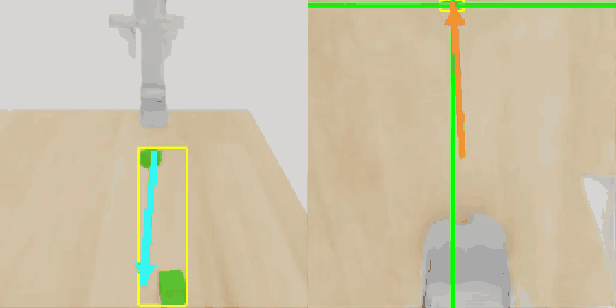
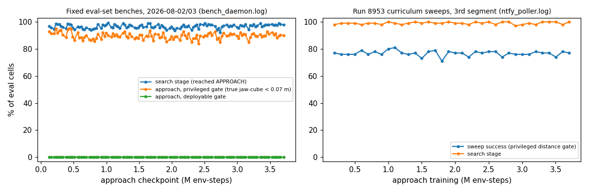
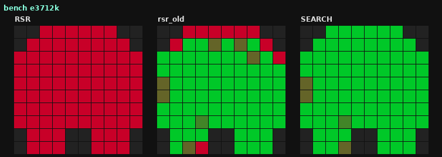
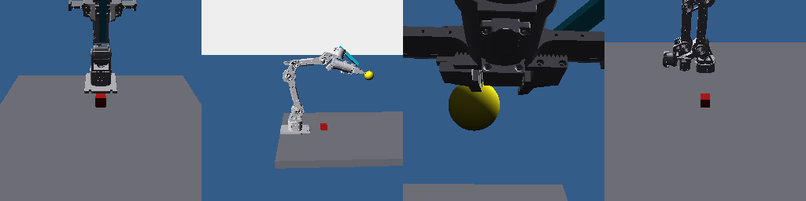

# reBot Cube Grasping: Staged RL in Simulation and Perception–IK Control on Hardware

Picking up a 4 cm cube with a low-cost 6-DoF arm (**reBot B601-DM**). The repository holds three separate results,
deliberately not merged into one sim-to-real story:

1. **Staged RL in simulation (main, July–August 2026).** A staged distributional C51-SAC in Isaac Lab whose policy
   sees only cube *detections* (front and wrist camera), cube yaw and proprioception. Stages: search → approach.
   Grasp and lift are a parameterised rule. How far it got is measured by logged benches and sweeps (Part 1).
2. **Moving the RL policies to the hardware failed.** Recorded attempts and their causes are listed (Part 2).
3. **A perception + inverse-kinematics + state-machine controller worked on the hardware**, according to the
   author's notes (July 2026). These results are not counted and there is no video (Part 3).

[](.github/workflows/ci.yml)
[](LICENSE)
· [Claims audit](docs/claims.md) · [Raw logs](results/project2/README.md) · [Provenance](docs/provenance.md)
· [Third-party notices](docs/third_party.md) · [Earlier stage (June)](docs/stage_2026-06_teacher_student.md)
· [Refactor log](docs/refactor_2026-11.md) · status: 2026-11-02 (code layout 2026-11-05)



*Simulation (S4), not the real robot. The included checkpoint pair of bench e3712k (search + approach), rendered on
2026-11-02 with seed 0 on 4 fixed cube positions (`scripts/eval/project2_eval.sh R`). Left: front camera; right: wrist
camera. Both are the detector-input views, with the detection box, the gripper-axis arrow (cyan) and the
direction-to-cube arrow (orange) drawn by the trainer. In all four episodes the policy searches, hands over to the
approach and reaches the cube by the privileged distance criterion (true jaw-to-cube distance < 0.07 m), which ends
the episode. The **deployable gate was not met in any of them**, and grasp and lift are not part of this run.*

**Contents:** [1. Status](#1-status-at-a-glance) · [2. Repository map](#2-repository-map) · [3. Pipeline](#3-pipeline) ·
[4. Install and test](#4-install-and-test) · [5. Method notes](#5-method-notes) · [6. Results](#6-results) ·
[7. Limitations](#7-limitations-what-this-repository-does-not-show) · [8. Overview and history](#8-overview-and-history) ·
[9. Hardware and attribution](#9-hardware-and-attribution) · [10. License and citation](#10-license-and-citation)

---

## 1. Status at a glance

| | What | Measured how | Not shown |
|---|---|---|---|
| **Works in simulation** | search and the geometric approach of the staged policy | 120 logged benches of 2026-08-02/03 and a seeded re-evaluation of 2026-11-02 with per-episode CSVs ([§6.1](#61-part-1--how-far-staged-rl-got-in-simulation)) | — |
| **Does not work in simulation** | the **deployable gate**: 0.0 % in all 120 benches and in every re-evaluation run | same | grasp and lift were never exercised: the rule grasp starts only after the deployable gate holds |
| **RL on the real robot** | **failed** (June camera student; July residual SAC) | the author's notes ([§6.2](#62-part-2--moving-rl-to-the-hardware-failed)) | no RL policy was shown working on hardware |
| **Perception + IK + state machine on the real robot** | real-robot execution of reach → grasp → lift recorded in the author's notes | notes only ([§6.3](#63-part-3--the-perception--ik--state-machine-path-worked-on-hardware-notes-only)) | no trial counts, no success rate, no video |

## 2. Repository map

| Path | What | Read this if… |
|---|---|---|
| [`src/rebot_grasp_rl/`](src/rebot_grasp_rl/README.md) | **Project 2 trainer** (main): staged C51-SAC on detections, eval-set benches, seeded re-evaluation hooks, cross-attention networks, robot profiles | you want the RL method and how the numbers were produced |
| [`src/rebot_grasp_env/`](src/rebot_grasp_env/README.md) | Project 2 simulation environment (July version of the LeIsaac reBot LiftCube configuration) | you want the observation / action / reward terms |
| [`src/rebot_teacher_student/`](src/rebot_teacher_student/README.md) | earlier stage (June): privileged teacher → DAgger camera students, Isaac-free deploy loops, seeded evaluation | you want the first sim-to-real attempt or a policy that runs without Isaac |
| [`src/rebot_grasp_common/`](src/rebot_grasp_common/README.md) | machine-specific paths with environment-variable overrides | you run the Isaac stages on your machine |
| [`scripts/`](scripts/README.md) | shell launchers: Isaac environment, training, re-evaluation, mock deploy | you want the exact commands |
| [`configs/`](configs/) | bench and training configurations of Project 2 (`*.env`), June reward configuration | you want the knobs behind a number |
| [`results/`](results/project2/README.md) | raw logs, parsed tables, heatmaps, re-evaluation CSVs ([`results/project2/`](results/project2/README.md)); the search (8,038,400 env-steps) and approach (3,712,000) checkpoints of the last logged bench and the June checkpoints ([`results/checkpoints/`](results/checkpoints/README.md)) | you want to check a number |
| [`analysis/`](analysis/README.md) | log parser, figure script, README claim checker, re-evaluation summary, provenance fingerprints, refactor-equivalence check | you want to verify the README |
| [`docs/`](docs/) | claims audit, provenance, third-party notices, simulation versions, June stage, deploy spec, refactor log | you want the long story or the audit trail |
| [`media/`](media/README.md) | GIFs, figures and rollout clips used here | you want to know where a picture comes from |
| [`archive/`](archive/README.md) | superseded or one-off code kept verbatim: July real-robot deploy record, June residual-pick record, June diagnostics and renders, Project 2 log tools | you want the hardware record (Part 3) |
| [`tests/`](tests/), [CI](.github/workflows/ci.yml) | layout and secret scan, parse / import checks, provenance fingerprints, refactor equivalence, characterization goldens, mock deploy | you want to know what is checked automatically |

**Start reading here:** [`src/rebot_grasp_rl/train.py`](src/rebot_grasp_rl/train.py) (top docstring, then the
`TWO_PHASE` loop) → [`src/rebot_grasp_rl/nets.py`](src/rebot_grasp_rl/nets.py) →
[`src/rebot_grasp_rl/eval_hooks.py`](src/rebot_grasp_rl/eval_hooks.py). Code that runs without Isaac:
[`src/rebot_teacher_student/deploy/visual_deploy.py`](src/rebot_teacher_student/deploy/visual_deploy.py).

## 3. Pipeline

| What | Module | Command | Runs without Isaac? |
|---|---|---|---|
| simulation environment (S4) | `rebot_grasp_env` | imported by the trainer | no |
| train search, then approach with search frozen | `rebot_grasp_rl.train` | below | no |
| bench / seeded re-evaluation | `rebot_grasp_rl.train` with `TP_EVAL=1`, `rebot_grasp_rl.eval_hooks` | `scripts/eval/project2_eval.sh` | no (dry run in CI) |
| rebuild the reported numbers | `analysis/parse_logs.py`, `analysis/project2_eval_summary.py`, `analysis/verify_claims.py` | below | yes |
| earlier stage: teacher → student → deploy | `rebot_teacher_student` | [June page, Pipeline](docs/stage_2026-06_teacher_student.md#7-pipeline) | deploy loops yes (mock robot); training no |


**Train (Project 2).** The approach training run whose checkpoints were benched (`det_TP304_refac_smoke9t`),
with the arguments recorded in its entrypoint file. The search policy is loaded frozen from `TP_EVAL_DIR`:
```bash
source scripts/isaac_env.sh
env $(grep -v '^#' configs/project2_train_9t_dacq_2026-08-02.env | xargs) PYTHONPATH=src \
  TP_EVAL_DIR=<folder with search_last.pt> LEISAAC_ASSETS_ROOT="$LEISAAC_ASSETS_ROOT" \
  "$PY" -u -m rebot_grasp_rl.train --num-envs 256 --total-timesteps 1000000000 --learning-starts 5000 \
  --buffer-size 1000000 --buffer-device cuda --batch-size 512 --num-updates 128 --alpha-floor 0.1 --alpha-lr 1.5e-5 \
  --target-entropy -3.5 --single-cube --headless --render-size 256 --detector <det_cube_obb_yolo26m_ft3.pt> \
  --det-conf 0.15 --gamma 0.97 --v-min -20 --v-max 400 --dr --dyn-dr --http-port 8953 --save-dir rl_output/det_TP304_refac_smoke9t
```
The benches ran the same trainer in eval mode with 32 environments and without domain randomisation
(`configs/project2_bench_2026-08-03.env`).

**Re-evaluate (seeded, per episode).** This is one Ray job on the GPU node; it writes `episodes.csv` and
`summary.json` (Wilson 95 % intervals) per run:
```bash
OUT=<output dir> bash scripts/eval/project2_eval.sh A B C       # A bench replica, B 400-case grid, C end-to-end (experimental)
python analysis/project2_eval_summary.py <output dir>/bench86   # recompute a summary
```

**Rebuild the reported numbers from the logs:**
```bash
python analysis/parse_logs.py && python analysis/plot_project2.py
```

## 4. Install and test

Isaac-free parts (log parsing, evaluation summary, tests, the June deploy loop):

```bash
python -m pip install -e ".[test]"      # numpy, pyyaml, pytest
python -m pip install torch matplotlib  # eval-hook test, June mock deploy, figures (CPU is enough)
python -m pytest -q
```

Simulation needs a Linux machine with an NVIDIA GPU, plus the following:
* Isaac Sim 5.1 and Isaac Lab 2.3 (Python 3.11 venv);
* the LeIsaac fork with the reBot robot configuration and its assets;
* `ultralytics`, and the YOLO-OBB cube detector weights (`--detector`).

`source scripts/isaac_env.sh` sets `REBOT_ISAAC_WS`, `LEISAAC_ASSETS_ROOT` and `PY`. None of the above is
redistributed here ([third_party.md](docs/third_party.md)).

What is checked, and how:


| Check | Command | What it shows |
|---|---|---|
| Log numbers | `python analysis/parse_logs.py --check` | `results/project2/log_summary.json` is exactly what the two raw logs contain |
| README numbers | `python analysis/verify_claims.py` | every percentage in this README is in the parsed log summary; every other number is in the file it is taken from |
| Tests | `python -m pytest -q` | parser, eval writer and Wilson summary on synthetic data, trainer argument parsing, layout and secret scan, imports, mock deploy |
| Re-evaluation | `python analysis/project2_eval_summary.py results/project2/reeval/bench86` (etc.) | recomputes rates and Wilson intervals from the committed per-episode CSVs |
| Refactor | `python analysis/refactor_equivalence.py` | every module moved in the 2026-11 restructure is its pre-refactor code up to renames (syntax tree and scopes); see the [refactor log](docs/refactor_2026-11.md) |

The Isaac stages (training, benches, re-evaluation, June training and evaluation) cannot run in CI; they are
compile-checked, and their pure-Python parts are covered by characterization tests.

## 5. Method notes


* **Observations (Project 2):** front and wrist cube detections (centre, area fraction, visibility), cube yaw
  (sin, cos), a front-camera aim token, and proprioception. There are no raw pixels and no privileged state
  (`NO_PRIV=1`). The tokens are fused by cross-attention (`nets.py`).
* **Actions:** search moves the arm toward a view of the cube. Approach outputs Cartesian deltas solved by
  differential IK (`APP_NO_YAW=1`: x, y, descend, pitch). Grasp and lift are a rule with policy-chosen parameters.
* **Learning:** C51 critic with 101 atoms; deterministic actions in benches and sweeps; spawn curriculum over a
  10×10 cell grid during training.

## 6. Results

### 6.1 Part 1 — how far staged RL got in simulation



*Left: 120 fixed eval-set benches of successive approach checkpoints (2026-08-02/03). The search stage and the
privileged reach criterion (true jaw-to-cube distance below 0.07 m) are high. The **deployable success gate stays at
0.0 % in every bench**. Right: curriculum sweeps of training run 8953 under its privileged distance gate. Every
number is rebuilt from the raw logs by [`analysis/parse_logs.py`](analysis/parse_logs.py).*

**Simulation version.** The latest version actually used (S4, July–August) is the author's reBot model (OURS) in the
LeIsaac LiftCube scene with a single cube, the July environment code and the calibrated wrist camera. The vendor
model (OFFICIAL) was set up but not used for any logged run ([simulation versions](docs/simulation_versions.md)).
The rollout videos of the June teacher show an earlier version (S1); they are on the
[earlier-stage page](docs/stage_2026-06_teacher_student.md).

All rates are fractions of eval cells or sweep cells. Each is reported with its stage, success criterion, date and
source file. Criteria, from the trainer code and the configuration files:

| Criterion | Meaning |
|---|---|
| **search** | the episode reached the APPROACH phase, i.e. the search policy handed over a cube seen and centred in the wrist camera |
| **privileged reach** | the true 3-D distance from jaw mouth to cube fell below a threshold. In the benches the threshold is 0.07 m, held 1 frame (`configs/project2_bench_2026-08-03.env`). This needs the simulator's true cube position, so it cannot be checked on the robot |
| **deployable gate** | wrist-image centring + jaw-mouth height + cube area fraction, all measurable on the robot |

| Stage | Criterion | Result | Date | Source |
|---|---|---|---|---|
| search | search | 92.1–99.4 % over 120 benches | 2026-08-02/03 | `results/project2/bench_daemon.log` |
| approach | privileged reach (< 0.07 m) | 84.0–95.2 % over 120 benches | 2026-08-02/03 | same |
| approach | **deployable gate** | **0.0 % in all 120 benches** | 2026-08-02/03 | same |
| search + approach, checkpoints in this repository | search / privileged reach / deployable | 97.8 % / 89.9 % / 0.0 % on 86 cells (bench of approach checkpoint 3,712k) | 2026-08-03 | same |
| approach (training run 8953, curriculum sweeps) | privileged distance gate | 71–81 % across 36 sweeps (max 81 % at 1,101k steps), search 97–100 % | about 07-31 → 08-01 (log has times, no dates) | `results/project2/ntfy_poller.log` |
| search (training run 8951) | search | 95–100 % over 61 sweeps | same period | same |
| **re-evaluation A** (replica of the 08-03 bench: 86 cells, cases revisited, 160 episodes, seed 0) | search / privileged reach (< 0.07 m) / deployable gate | 99.4 % (96.5–99.9) / 88.1 % (82.2–92.3) / **0.0 % (0.0–2.3)** | 2026-11-02 | `results/project2/reeval/bench86/` |
| **re-evaluation B** (400-case 20×20 grid, one episode per case, seed 0) | search / privileged reach (< 0.07 m) / deployable gate | 98.5 % (96.8–99.3) / 73.0 % (68.5–77.1) / **0.0 % (0.0–0.9)** | 2026-11-02 | `results/project2/reeval/grid400/` |
| **re-evaluation C** (experimental end-to-end: grasp/lift rule on, episodes not ended at the reach; 86 cells, 86 episodes, seed 0) | search / lift | 97.7 % (91.9–99.4) / **0.0 % (0.0–4.3)**; privileged reach not measured in this run | 2026-11-02 | `results/project2/reeval/staged_e2e/` |

Re-evaluation rates are over episodes, with Wilson 95 % intervals in parentheses. All three runs used the included
checkpoint pair, the bench configuration and seed 0, and ran on 2026-11-02 in simulation S4 as one job on the
second workstation (`scripts/eval/project2_eval.sh A B C`). They have per-episode CSVs. Run A reproduces the
logged bench of 08-03 (search 97.8 %, privileged 89.9 %, deployable 0.0 %) within its intervals. **Run C cannot
test grasping**: the rule grasp starts only after the deployable gate holds, which never happens, so its lift rate
of 0.0 % says nothing about the grasp/lift rule itself. It also measures no privileged reach, because the reach
threshold is switched off so that episodes run to the end.



*Per-cell results of the bench of the included checkpoints. Each grid is lateral position × forward distance, far
cells at the top; dark cells were not evaluated. Deployable gate (all red), privileged reach, search.*



*Simulation views of the OFFICIAL (vendor USD) robot model used when calibrating its cameras (front, side, wrist;
the yellow sphere marks the camera aim), 2026-07-23. Simulation only.*

What this shows: the search and the geometric approach were learned in simulation. The approach does not satisfy the
gate a real robot could check, so the trained policy never reaches a state from which the rule grasp would start.
Grasp and lift were not part of these benches.

### 6.2 Part 2 — moving RL to the hardware failed

| When | What ran on the real arm | Recorded outcome | Recorded cause | Source |
|---|---|---|---|---|
| 2026-06-10/11 | camera-based DAgger student (earlier stage) | did not work: actions collapsed or saturated | camera input out of distribution: 16:9 frames squashed to a square, glare, a different background; the wrist-camera view differed from simulation; the start pose did not match the simulated REST pose | [`docs/deploy/DEPLOY_GUIDE.md`](docs/deploy/DEPLOY_GUIDE.md), commit messages, notes outside this repository |
| 2026-07-13 | residual SAC on top of a rule reach ("hover07e") | failed at the run gate: the arm rose instead of descending | observations out of distribution; the residual accumulated until the joint limits | [`archive/real_robot_july/docs/20_…`](archive/real_robot_july/docs/20_handoff_hover07e_sac_deploy_bringup.md) |
| Project 2 policies | — | no real-robot run found | — | — |

### 6.3 Part 3 — the perception + IK + state-machine path worked on hardware (notes only)

| When | Recorded in the author's notes | Source |
|---|---|---|
| 2026-07-07 | a full real-robot pick (reach → grasp → lift) confirmed to work | [`archive/real_robot_july/docs/14_…`](archive/real_robot_july/docs/14_handoff_vision_token_retrain.md) |
| 2026-07-13/14 | grasp and lift succeeded after re-verifying a forward-kinematics height correction (cube lifted off the table) | [`…/22_…`](archive/real_robot_july/docs/22_handoff_grasp_lift_verified_and_lookat_rnd.md) |
| 2026-07-23 | automatic grasp cycle succeeded on a cube at an arbitrary angle, after fixing a joint-calibration file that was no longer loaded | [`…/33_…`](archive/real_robot_july/docs/33_handoff_grasp_working_jointmap_reachZ_yaw.md) |
| 2026-07-23 | RL removed from that code base: the project became perception + IK + state machine only | [`…/34_…`](archive/real_robot_july/docs/34_handoff_readability_cleanup_rl_removal_main_consolidation.md) |

There are no trial counts, no success rate and no video. The notes list a repeatability sweep over cube positions and
angles as still open.

## 7. Limitations (what this repository does NOT show)

* **No RL policy was shown working on the hardware.** The real-robot successes come from the rule / IK pipeline, and
  they are recorded in the author's notes without counts or video.
* **No successful sim-to-real transfer of a learned policy**, in either stage.
* **In simulation the deployable success gate was 0.0 % in all 120 benches.** The high rates use the search
  criterion or a privileged distance that only the simulator knows.
* **No end-to-end (grasp + lift) success in simulation.** The benches end at the reach. The end-to-end re-evaluation
  (run C) measured lift 0.0 % over 86 episodes, but the grasp rule is only triggered through the deployable gate,
  which no episode met, so the grasp/lift rule itself was never exercised.
* **The August numbers come from aggregate logs.** The two logs aggregate per bench or per sweep, July training
  logs are no longer on the cluster, and the sweep log carries no dates. Only the 2026-11-02 re-evaluation has
  per-episode files.
* **The sweep criterion changed between runs.** All training entrypoints used the privileged gate for sweeps, with a
  distance threshold of 0.07–0.14 m depending on the run's configuration file. The threshold is not printed per sweep.
* **The real-robot code is a record, not runnable.** Files with lines by a colleague (IK engine, constants, scene
  set-up) are excluded ([provenance §10](docs/provenance.md#10-real-robot-code-july-blame-at-7f36e69)).
* **Not reproducible end to end from this repository alone.** Isaac Sim / Isaac Lab, the LeIsaac fork with the reBot
  configuration, the robot assets and the YOLO-OBB cube detector weights (188 MB) are not included.

## 8. Overview and history

**Research question.** *Can a cube-grasping skill be learned in simulation from detection-level observations that
also exist on the real robot, and what actually works when it meets the hardware?*

| Part | Period | What | Code | Evidence in this repository |
|---|---|---|---|---|
| Earlier stage | 2026-06-08 → 06-12 | privileged-state C51-SAC teacher → DAgger camera students; first real-robot attempt | `src/rebot_teacher_student/` | code, checkpoints, commit-recorded numbers only ([details](docs/stage_2026-06_teacher_student.md)) |
| **1. RL in simulation** | 2026-07-14 → 08-12 | staged DET-xattn C51-SAC (search → approach, rule grasp/lift); OURS (converted URDF) and OFFICIAL (vendor USD) robot models | `src/rebot_grasp_rl/` | raw bench and sweep logs, 124 heatmaps, the benchmarked checkpoint pair, the bench configuration |
| **2. RL on hardware** | 2026-06-10/11, 2026-07-13 | camera student and residual SAC run on the real arm | `src/rebot_teacher_student/deploy/`, notes | author's notes; **failed** |
| **3. Rule / IK on hardware** | 2026-07-06 → 07-24 | detection → 3-D cube estimate → IK approach → state-machine grasp and lift | `archive/real_robot_july/` (record only) | author's notes; **worked, uncounted** |

### Current vs. superseded


| Current | Superseded |
|---|---|
| Project 2 staged DET-xattn C51-SAC (`src/rebot_grasp_rl/`) | June privileged-state teacher → DAgger students (`src/rebot_teacher_student/`) |
| perception + IK + state machine on hardware (July record) | residual SAC on hardware (failed 07-13); June camera student on hardware (failed) |
| trainer copy of 2026-08-02 15:39 (the one the benches ran) | copies of 07-23 and 08-01/02 kept on the training machines ([provenance §9](docs/provenance.md#9-july--august-2026-sources)) |

## 9. Hardware and attribution


* **Robot:** reBot B601-DM (Seeed Studio): 6 joints and a parallel gripper; Damiao motors. Cameras: a fixed front
  camera and a wrist camera (Logitech C922). Two robot models in simulation: OURS (the author's URDF→USD conversion)
  and OFFICIAL (Seeed's `reBot-Isaacsim` USD, MIT). Neither is redistributed.
* **Software:** NVIDIA Isaac Sim / Isaac Lab; LeIsaac (Apache-2.0); C51-SAC after Squint (MIT); YOLO-OBB detector
  trained with Ultralytics (AGPL-3.0, installed, not included); OWLv2 open-vocabulary detection in the July deploy.
* **Authorship:** all code here is the author's. Files of the residual-pick repository with lines by a colleague are
  excluded by `git blame` ([provenance](docs/provenance.md)). Files shared with the author's earlier SO-101 project
  were removed from this version, except one configuration file.

## 10. License and citation


Code: [PolyForm Noncommercial 1.0.0](LICENSE). Credits: [`NOTICE`](NOTICE), [`LICENSES/`](LICENSES/). To cite, use [`CITATION.cff`](CITATION.cff).
