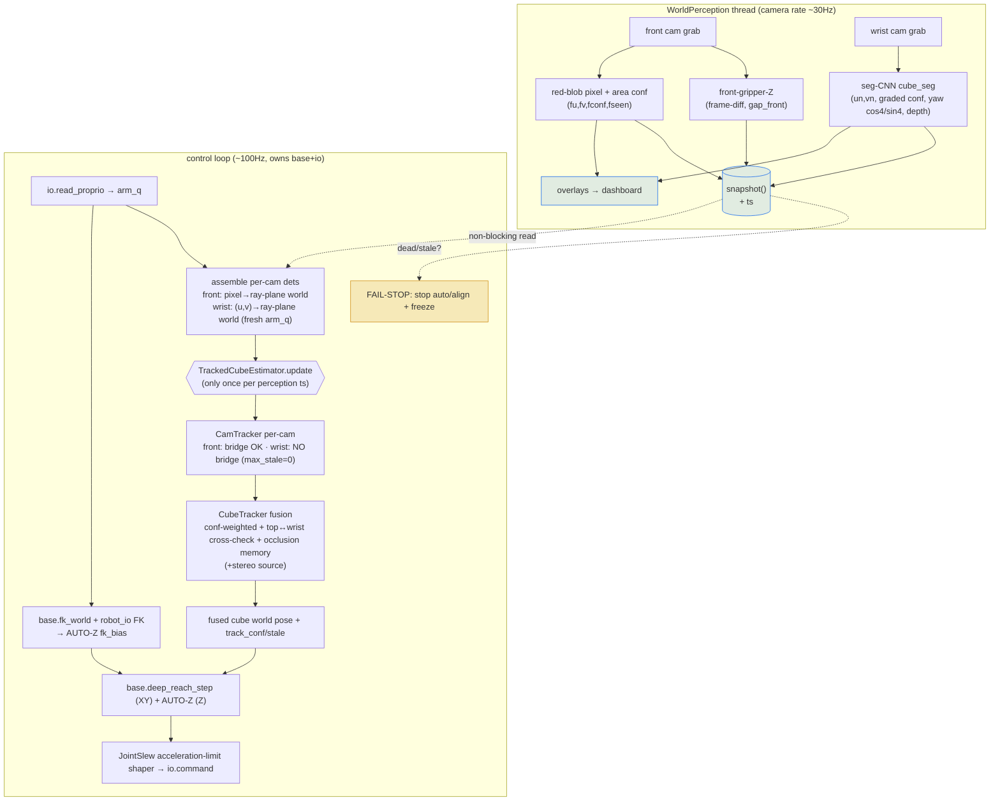
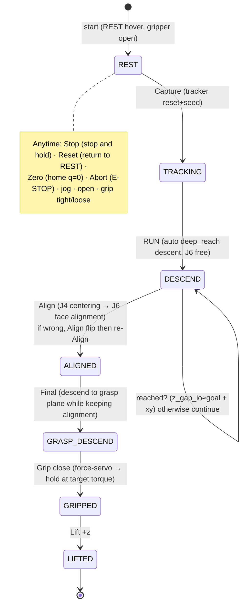

# deep_reach_world.py — usage · operation diagrams · dashboard guide

> Branch `perception-topwrist-coop`. **A real-robot deploy tool that drives Deep-Reach with a "fused, tracked cube WORLD pose".**
> The verified `debug_deepreach.py` (one-shot capture baseline) is **left untouched**; only its pure helpers are imported and reused.
> Difference: one-shot front capture → reach with an **occlusion-surviving cube pose** produced by the **per-frame B↔A(+C) perception path** (front+wrist seg-CNN → per-cam CamTracker →
> unproject/stereo → CubeTracker fusion + occlusion memory).

---

## 1. One-line summary + what is different

| | `debug_deepreach.py` (baseline, HW verified) | **`deep_reach_world.py` (this tool)** |
|---|---|---|
| Cube XY source | **one-shot** front-cam capture (fixed, reused for every frame) | **fused and tracked every frame** (front+wrist, occlusion memory) |
| front detection | HSV red-mask (pure red) | HSV red-mask + **area graded conf** |
| wrist detection | CNN (u,v[,depth]) — binary vis | **seg CNN cube_seg** — (u,v)+**graded conf** (vis×seg-peak)+yaw+depth |
| Fusion | ad-hoc wrist correction inside deep_reach_step | **TrackedCubeEstimator** (CamTracker→CubeTracker[+stereo]) |
| Occlusion handling | none (fixed pose) | when the front cam is occluded by the arm, **servo on wrist + pose coast** |
| Control layer | same (deep_reach_step / AUTO-Z / force-servo / latch / fail-stop) | **same** (helpers reused) |

**Status**: offline verification done (unit tests, CPU detection, adversarial review), **real-robot (HW) verification pending.** Defaults are conservative.

---

## 2. Running (CLI)

```bash
cd ~/workspace/rebot_sim2real
.venv-deploy/bin/python deploy/deep_reach_world.py \
    --front-exposure 78 --wrist-exposure 78          # C922 auto exposure washes the image out white → manual exposure required
# dashboard: http://localhost:8899   (remote: ssh -L 8899:localhost:8899)
```

### Main flags

| Flag | Default | Meaning |
|---|---|---|
| `--config` | `configs/train_v6a_yaw.yaml` | env config used by base_controller (FK/reach parameters) |
| `--calib` | `deploy/calib.npz` | front-cam K + T_cam2world (+dist) |
| `--wrist-detector` | `ckpt/cube_detector_wrist_seg.pt` | must be a **seg** ckpt to get graded conf (otherwise red-mask fallback = binary) |
| `--stereo` | off | **feature C**: adds a front-ray×wrist-ray triangulation source (off-plane/variable-height cube). On a flat surface ray-plane is more accurate → default off |
| `--base-z` | `0.010` | URDF base_link z (pedestal correction); reference for AUTO-Z fk_bias |
| `--grasp-zgap-io` | `0.001` | grasp-ready target `z_gap_io` (exact height per robot_io FK). Gate `|z_gap_io−this value|<0.015` |
| `--z-bias` / `--no-auto-z` | `0.05` / off | AUTO-Z initial value / (if disabled) fixed descent depth |
| `--grip-force` | `0.07` | FORCE_POS torque cap [0,1] (robot_io HARD-CLAMPs at 0.18; the gripper broke twice at 0.3 in the past) |
| `--grip-torque-target` | `0.8` | force-servo target torque (close gently and hold, crush≈1.86, cap 1.2) |
| `--front-exposure`/`--wrist-exposure` | auto | **manual exposure** (78 typical). auto = white-out |
| `--front-dev`/`--wrist-dev` | `/dev/video_front`·`/dev/video_wrist` | udev symlinks (prevent front↔wrist swap from kernel re-enumeration) |
| `--x-corr` | `0.0235` | constant correction of residual front-cam extrinsic x (−2.35cm after checkerboard calib) |
| **Tracking knobs** | | |
| `--front-area-ref` | `500` | front red-blob area (px) = conf 1.0 reference. When partly occluded by the arm, red↓ → conf↓ → wrist leads the fusion |
| `--front-gate-px` | `90` | front CamTracker outlier gate (px; fixed cam, so the cube barely moves) |
| `--wrist-gate` | `0.45` | wrist CamTracker gate (**normalized** units, frame=2.0) |
| `--cam-ema` | `0.5` | per-cam (u,v) EMA (detection jitter smoothing) |
| `--max-stale` | `15` | number of frames before the **front** (fixed cam) track drops. **wrist is always 0 in code** (moving eye = no pixel bridging) |
| `--conf-floor` | `0.05` | if the fused conf is below this, the pose is invalid (RUN/Final do not proceed) |

---

## 3. Operation diagrams

### 3.1 2-thread architecture + fusion path



**Key design points**
- **Fusion runs in the control loop** (because the wrist unproject must use a **fresh arm_q every frame**). The thread only publishes detections.
- `est.update` is called **only when the perception ts changes** (≈30Hz) — the stale/decay/EMA knobs of CamTracker/CubeTracker are frame-count based, so running them at 100Hz would exhaust them 3× faster.
- **front (fixed cam)**: pixel bridging is valid (hold the last pixel during occlusion → same world point). **wrist (moving eye)**: pixel bridging is forbidden (`max_stale=0`) — reprojecting a held pixel with a moved arm makes the world point drift, so the occlusion coast is handled by **CubeTracker's world memory**.
- **XY = fused pose**, **Z = AUTO-Z closed loop** (robot_io FK is the exact truth; base-FK underread is cancelled by fk_bias). Stereo z is display only (descent uses the flat-surface z).

### 3.2 GRASP flow (dashboard button order)



> Warning: **The arm moves only on RUN/Align/Final/Grip/Lift/jog.** Abort (E-STOP) is always available, and if a camera feed
> dies or goes stale (>0.5s), auto/align stop automatically and the arm freezes at the current pose.

---

## 4. Dashboard usage (http://localhost:8899)

### 4.1 LIVE camera panels (verify by eye)
- **FRONT**: cube xy marker (orange, projected world) + gripper frame-diff detection (green) + FK-prior search box (gray). → check that front cube detection and the gripper-Z input are sane.
- **WRIST**: screen-center crosshair (= alignment/centering target) + detected (u,v) (green = CNN) + red-mask seg orientation box (magenta) + in-image yaw. → check cube centering ((u,v) vs center) and alignment angle (box vs screen axes).

### 4.2 Status table (`gates`) — what to look at
| Reading | Meaning / what to check |
|---|---|
| `track_conf` / `track_stale` | **fused confidence / number of frames coasted without observation.** conf must be above `conf_floor` (0.05) for the pose to be valid |
| `src_front_conf` / `src_wrist_conf` | graded conf each camera contributes to the fusion (drops automatically when occluded) |
| `fused_z` | stereo triangulation z (display only; descent uses the flat-surface z) |
| `front_seen` / `front_conf` | whether the front red blob is detected + area conf |
| `cube_top` / `grasp_xy` / `xy_err` | tracked cube xy / jaw-forward-corrected target / TCP↔target error |
| `z_gap_io` | **exact** height above the surface per robot_io FK → **reference for the grasp-ready gate** (≈`grasp_zgap_io`) |
| `z_gap_front` / `z_gap_fk` / `z_gap_med` | front-gripper geometry / base-FK / median fused Z gap |
| `fk_bias` | robot_io_z − base_ctrl_z (base-FK underread; cancelled by AUTO-Z) |
| `z_bias` | current descent depth (AUTO-Z automatic or fixed) |
| `cnn_yaw_deg` / `seg_yaw_deg` / `yaw_src` | CNN yaw head vs red-mask seg yaw — **compare the two to decide whether to trust the CNN yaw** (if they differ, `--yaw-src seg`) |
| `align_top_vn` / `align_top_vn_goal` | Align auto-centering: cube top-edge y / target (≈ bottom 40%) |
| `grip_tau` / `grip_tau_target` / `grasped` | gripper motor torque / force-servo target / grasp decision (torque>0.5) |
| `reached` | **exact arrival** (z_gap_io≈goal + xy) — RUN stop condition |

### 4.3 Buttons
| Button | Action |
|---|---|
| **Capture** | tracker **reset + seed with the current front estimate** (acquire the target immediately; live tracking afterwards) |
| **RUN** | repeat auto deep_reach descent (until `reached`, J6 free). Stop with Stop/Hold/Abort |
| **Align** / **Align flip** | center the cube top edge with J4 → align to the face with J6 / reverse the J6 rotation direction |
| **Final** | descend from align-hover to the grasp plane (AUTO-Z, keep J6 alignment) |
| **Grip close** / **open** | close gently with force-servo up to `grip_torque_target` and hold / open |
| **grip tighter/looser** | target torque ±0.1 (not position; only if slipping) |
| **Lift +z** | raise TCP +z (keep grasp, lift test) |
| **Stop** / **Reset** / **Zero** / **Abort** | stop and hold / return to REST / home q=0 / **E-STOP** |

---

## 5. Real-robot bring-up checklist (step by step, avoid running large amounts blind)
1. **Camera identity**: confirm by eye that the FRONT/WRIST panels are not swapped (otherwise swap `--front/wrist-dev`).
2. **Exposure**: with `--front/wrist-exposure 78`, check for no white wash-out.
3. **Capture** → check that `cube_top` matches the actual cube position (orange marker in the front panel).
4. **track_conf/stale**: when the cube is occluded, conf should drop smoothly and the pose be held (occlusion memory works).
5. **RUN** (briefly) → `z_gap_io` converges to `grasp_zgap_io` (≈0), `reached=true`.
6. **Align** → in the wrist panel the jaw aligns with the face (cnn_yaw≈0); Align flip if needed.
7. **Final → Grip close** (grip_tau stops at the target and `grasped=true`) → **Lift**.
8. **stereo** (`--stereo`) only for variable height/off-plane; unnecessary on a flat surface.

---

## 6. Known limitations / cautions
- **Not HW verified**: the flow above is only verified offline (unit, CPU, review). Check real-robot sign/convergence step by step.
- **The top/front seg CNN is effectively red-keyed** (top datagen uses only non-red distractors) → weak against red backgrounds. The deploy front uses HSV red-mask anyway. If robustness to red clutter is needed, add red distractors to the top datagen and retrain.
- **The wrist seg CNN detects the red CUBE object** (trained to reject red clutter) — but identical red right next to the cube can confuse it (near-cube red excluded in datagen).
- The front-ray of `--stereo` applies x_corr approximately (exact on a flat surface, approximate off-plane).

Related: `debug_deepreach.py` (baseline), `deploy/cube_detector_io.py` (cube_seg), `src/rebot_sim2real/perception_fusion.py` (TrackedCubeEstimator).
