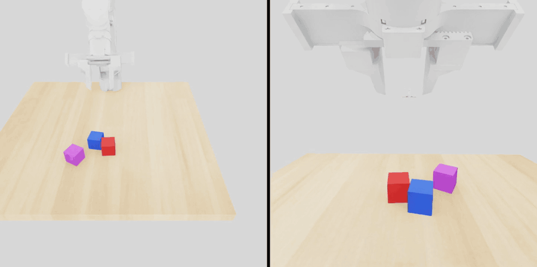
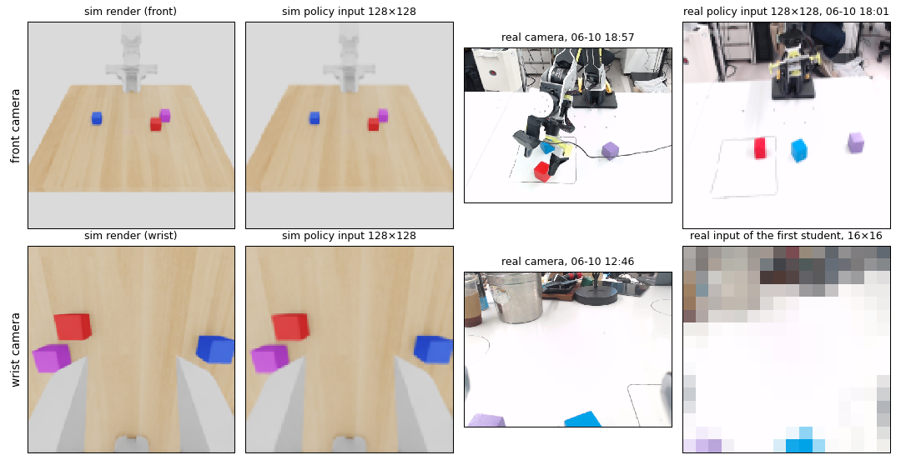
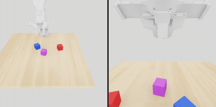
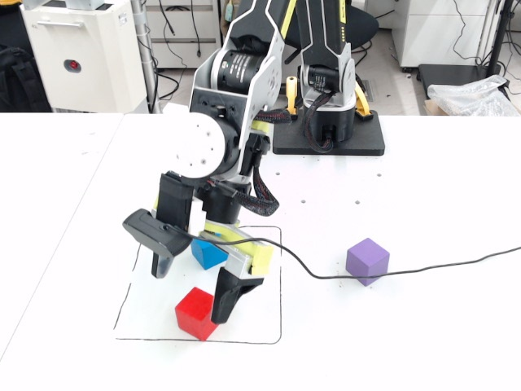
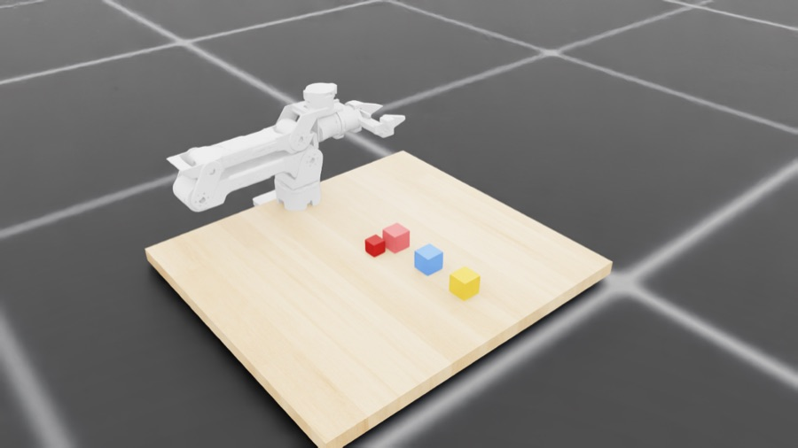

# Earlier stage (June 2026): privileged-state C51 SAC teacher distilled into camera-based students

This page is the documentation of the first stage of the project (2026-06-08 → 06-12), moved here from the README
when the July–August work became the main pipeline. The code is in `src/rebot_teacher_student/` and the shipped checkpoints
in `results/checkpoints/teacher/`, `results/checkpoints/student/`. The July Project 2 trainer imports a later version of this
stage's environment code (`src/rebot_grasp_env/`; differences in [provenance §9](provenance.md#9-july--august-2026-sources)).
Section numbers below are those of the earlier README.

**State-only teacher in simulation, earlier simulation version S1** (June environment, 3 cubes; see
[simulation versions](simulation_versions.md)). HD render of one rollout, front view and close view, made on
2026-06-10 with `render_teacher_hq.py`; the cube is lifted in this rollout. **Not a real-robot video, and not the
latest simulation version.**




## 1. Overview

| Step | What happens | Code | Output |
|---|---|---|---|
| 0. Environment | LeIsaac LiftCube task re-configured for the reBot: 43-D privileged observation, 7-D delta-on-target action with hard joint limits, Squint-style reward, success = cube lifted + grasped + arm back near REST | `src/rebot_teacher_student/env/` | env config |
| 1. Teacher | distributional-C51 SAC on the privileged state (single policy; also a jointly trained multi-stage variant) | `src/rebot_teacher_student/teacher/` | `c51_*.pt` |
| 2. Student | DAgger: the frozen teacher labels the states the student visits; the student regresses the teacher's action from two 128×128 RGB images + 21-D proprioception; optional visual domain randomisation | `src/rebot_teacher_student/student/` | `dagger_*.pt` |
| 3. Evaluation | seeded, headless, deterministic roll-outs of the shipped checkpoints with per-episode CSV output | `scripts/eval/` | `results/` |
| 4. Deploy | torch-only control loop that rebuilds the observation and the action limits outside Isaac; mock robots for testing | `src/rebot_teacher_student/deploy/`, `docs/deploy/` | motor targets |

## 2. Key findings

* **Motion limits live in the action term, not in the reward.** The arm moves by a bounded delta on its own target
  (0.05 rad per step) with hard per-joint limits and an elbow gate enforced inside the action term, and the deploy
  controller repeats the same limits one to one. The reward keeps only bounded terms, which matters for a
  distributional critic whose value support is fixed to [-20, 20] (`src/rebot_teacher_student/env/env_config.py`,
  `src/rebot_teacher_student/env/target_delta_action.py`, `src/rebot_teacher_student/teacher/train_c51.py`).
* **Teacher-student distillation removes perception from the deploy side.** The teacher needs the cube pose; the
  student needs only images and joint readings, so the deploy loop needs no cube detector, forward kinematics or
  grasp heuristic (`src/rebot_teacher_student/deploy/visual_deploy.py`).
* **Simulator conventions had to be measured, not assumed.** The gripper's opening direction was measured in
  simulation and turned out opposite to the earlier note, and the commanded gripper range was capped to the measured
  safe range so that the policy cannot command the mechanical maximum opening (`archive/june_sim_tools/diag_gripper_stroke.py`, [deploy spec §5](deploy/DEPLOY_SPEC.md)).
* **A real-robot attempt exposed observation and camera-viewpoint mismatch.** The deploy guide in this repository
  records that the visual policy collapsed on the real cameras (16:9 frames squashed to a square, glare, a different
  background); notes kept outside this repository add that the real arm's start pose (HOME) did not match the
  simulated REST pose and that the wrist-camera view was out of the training distribution. Fixes followed (centre
  crop, office-background and wrist-mount randomisation, recalibrated camera mounts), but no successful real-robot
  pick by these policies was recorded ([claims](claims.md)).

### What the student sees, in simulation and on the real robot



*Top: front camera; bottom: wrist camera. Columns: simulated render, simulated policy input, real camera frame, real
policy input. The real frames were saved during real-robot diagnosis on 2026-06-10 (the bottom-right image is the
input of the first, low-resolution student). The real wrist camera looked over a cluttered bench instead of down
between the jaws, and the real table, background and lighting differ from the simulated ones: this is the
observation mismatch the real-robot attempt ran into. The simulated renders show the camera mounts of the later
students (`media/cam_spec/`).*

| | | |
|---|---|---|
|  |  |  |
| Teacher, another simulated rollout from the same render run (cube lifted). | Real front camera during real-robot diagnosis of the camera-based student, 2026-06-10: the arm next to the target cube. The outcome of this attempt was not recorded. | The first reBot scene after importing the robot into Isaac Sim (2026-06-08), before the final three-cube layout. |

All media, their sources and checksums: [media/README.md](../media/README.md).

## 3. What this repository does NOT show

* **No successful sim-to-real transfer.** There is no video, log or counted trial of the real robot picking the cube
  with the teacher or a student. The real-robot runs were attempts that exposed mismatches (§2).
* **No training logs.** No training curve, TensorBoard file or evaluation log of the original runs survived. Success
  rates written in the original commit messages are listed in [docs/claims.md](claims.md) as unverified and are
  **not** used as results here.
* **No record of the parallel-environment count actually used.** The teacher script defaults to 1,024 environments
  and the student script to 128; what each committed checkpoint was trained with was not logged.
* **Not reproducible end to end without the vendor assets.** Isaac Sim, the LeIsaac fork with the reBot robot
  configuration and the reBot URDF / USD are not included (licences, size); see [Installation](#6-installation).
* **The archived residual-RL pick project does not run.** `archive/residual_pick_2026-06/` holds only the author's
  files of a later project with mixed authorship; the files it depends on are excluded ([provenance §6](provenance.md#6-source-c--rebot_sim2real-residual-rl-pick-and-hybrid-deploy-selected-by-git-blame)).

## 4. Results

**Not re-evaluated.** A seeded headless evaluation of the shipped checkpoints (`scripts/eval/`) was prepared but not
run: the only GPU it was allowed to use was occupied by another training job for the whole time window. No success
rate is reported in this repository. How to run it and what it writes: §7, Stage 3.

## 5. Components

| Component | Path | Status | Description |
|---|---|---|---|
| Environment | [`src/rebot_teacher_student/env/`](../src/rebot_teacher_student/env/) | current | `env_config.py` (observation, action, reward, success, cube reset, motor/friction set-up), `rewards.py` (reward terms, success latch and counters), `target_delta_action.py` (delta-on-target joint action with limits and elbow gate), `visual_obs.py` (camera mounts, 21-D student state, domain randomisation) |
| Teacher | [`src/rebot_teacher_student/teacher/`](../src/rebot_teacher_student/teacher/) | current | `train_c51.py` (single teacher), `train_c51_joint.py` (jointly trained stage actors), `train_c51_staged.py` (sequential stages, superseded), `infer_staged.py` |
| Student | [`src/rebot_teacher_student/student/`](../src/rebot_teacher_student/student/) | current | `visual_nets.py`, `train_dagger_visual.py` (main), `train_dagger_staged.py`, `train_visual_rl.py` / `train_visual_rl_staged.py` (visual C51 fine-tuning), `train_c51_visual.py` (visual RL from scratch) |
| Dashboard | [`src/rebot_teacher_student/dashboard.py`](../src/rebot_teacher_student/dashboard.py) | current | live web dashboard of the trainers |
| Tools | [`archive/june_sim_tools/`](../archive/june_sim_tools/README.md) | archived 2026-11-05 | rollout renders, camera / gripper / contact diagnostics |
| Deploy | [`src/rebot_teacher_student/deploy/`](../src/rebot_teacher_student/deploy/), [`docs/deploy/`](deploy/) | current | `state_deploy.py` (state-only), `visual_deploy.py` (camera-only), `dump_sim_spec.py`; deploy spec and guide |
| Evaluation | [`src/rebot_teacher_student/evaluate.py`](../src/rebot_teacher_student/evaluate.py), [`scripts/eval/run_all.sh`](../scripts/eval/run_all.sh) | current (written for this repository) | seeded evaluation and its launcher |
| Checkpoints | [`results/checkpoints/`](../results/checkpoints/README.md) | current | 3 checkpoints, 15 MB |
| Stage scripts | [`scripts/teacher/`](../scripts/teacher/), [`scripts/student/`](../scripts/student/), [`scripts/deploy/`](../scripts/deploy/) | current | the commands of §7 |
| Analysis | [`analysis/`](../analysis/) | current | `verify_claims.py` (README numbers vs. their source files), `ast_normalize.py` + `code_fingerprints.json` (moved code vs. originals), `refactor_equivalence.py` (2026-11 restructure) |
| Media | [`media/`](../media/README.md) | current | README GIFs and figures (`media/readme/`), teacher rollout clips, camera renders; sources and checksums in its README |
| Archive | [`archive/residual_pick_2026-06/`](../archive/residual_pick_2026-06/README.md) | record only | the author's files of the later residual-RL pick project |
| Tests | [`tests/`](../tests/), [`.github/workflows/ci.yml`](../.github/workflows/ci.yml) | current | layout and text checks, parse / import resolution, code fingerprints, mock deploy runs |

## 6. Installation

Isaac-free parts (deploy loop, tests, analysis):

```bash
python -m pip install -e ".[test]"      # numpy, pyyaml, pytest
python -m pip install torch             # deploy loop and mock tests (CPU is enough)
python -m pytest -q
```

Simulation (training, evaluation, renders) needs, on a Linux machine with an NVIDIA GPU:

* Isaac Sim 5.1 and Isaac Lab 2.3 in a Python 3.11 virtual environment;
* LeIsaac with the reBot robot configuration installed in that environment (it registers `LeIsaac-SO101-LiftCube-v0`
  and provides `MirroredTargetDeltaGripperAction`), and its assets including the reBot USD;
* `source scripts/isaac_env.sh` (sets `REBOT_ISAAC_WS`, `LEISAAC_ASSETS_ROOT`, `PYTHONPATH=src`, `PY`).

The LeIsaac fork and the reBot USD are not part of this repository ([third_party.md](third_party.md)).

## 7. Pipeline

Run from the repository root.

**Stage 1 — teacher.**
```bash
bash scripts/teacher/train_teacher.sh            # train_c51: --num-envs 1024 --success-target 5000; dashboard :8890
bash scripts/teacher/train_joint_teacher.sh      # jointly trained stage actors
```
The single-teacher command is the one recorded for the first teacher; later teachers resumed from earlier ones with
success-rate stop criteria (`--resume`, `--success-rate-target`, `--min-sr-hits`) whose exact values were not recorded.

**Stage 2 — student.**
```bash
TEACHER=results/checkpoints/teacher/c51_v5g_final.pt bash scripts/student/train_student.sh          # DAgger, 128 envs
TEACHER=results/checkpoints/teacher/c51_v5g_final.pt bash scripts/student/train_student.sh --dr     # + visual domain randomisation
```
DAgger anneals the probability that the teacher drives an environment from 1 to 0 over 150,000 steps; the student is
trained on the teacher's action at every visited state (mean-squared error on the squashed action).

**Stage 3 — evaluation** (seeded, headless; one Isaac process per checkpoint; CSV per episode + JSON summary):
```bash
source scripts/isaac_env.sh
"$PY" -m rebot_teacher_student.evaluate --mode single --ckpts results/checkpoints/teacher/c51_v5g_final.pt \
      --tag teacher_v5g --num-envs 64 --episodes 128 --seed 0 --out-dir results/eval
CKPT_ROOT=<folder with the original rl_output trees> OUT=results/eval bash scripts/eval/run_all.sh   # all checkpoints
```

**Stage 4 — deploy.**
```bash
bash scripts/deploy/mock_deploy.sh               # both deploy loops against mock robots, torch only
```
For the real robot, implement `RobotInterface` (state-only: joints, cube pose, gripper-link pose, grasp flag) or
`VisualRobotInterface` (joints, front and wrist images) as described in [docs/deploy/](deploy/README.md).

## 8. Codebase guide

* **Observation (teacher, 43-D):** joint positions (8) and velocities (8), commanded targets (7), distance to REST (6),
  cube position (3) and quaternion (4), tool-centre point (3), tool-to-cube vector (3), grasp flag (1).
* **Observation (student):** 21-D proprioception (joint positions, commanded targets, distance to REST) + front and
  wrist RGB, both 128×128 (`env/visual_obs.py`).
* **Action (7-D):** delta on the commanded joint target for 6 arm joints + 1 gripper, at 10 Hz; episodes last 10 s.
* **Success:** the cube is at least 1 mm above its resting height, both fingers touch it, and the commanded arm
  configuration is within 0.2 rad of REST (`env/rewards.py:isFoldSuccess`).
* **Teacher network:** tanh-Gaussian actor; distributional critic with 101 atoms on [-20, 20], an ensemble of 2;
  discount 0.9; 32 gradient updates per environment step by default (`teacher/train_c51.py`).
* **Where to start reading:** `env/env_config.py:configureEnv` → `teacher/train_c51.py` → `student/train_dagger_visual.py`
  → `deploy/visual_deploy.py`.

## 9. How to verify

| Check | Command | What it shows |
|---|---|---|
| Tests | `python -m pytest -q` | layout, no machine-specific strings, every file parses, internal imports resolve, moved code unchanged, both deploy loops run on the shipped checkpoints |
| README numbers | `python analysis/verify_claims.py` | every number in this README appears in the file it is taken from |
| Moved code vs. originals | [docs/provenance.md §2](provenance.md#2-what-was-changed-on-the-way-in) | 38 of the 39 kept Python files have the same normalised syntax tree as the originals (the exception differs in three translated UI labels); checked on commit `47398fd`, and the 2026-11 restructure is checked to be a move + rename of that commit ([refactor log](refactor_2026-11.md)) |

## 10. Current vs. superseded

| Current | Superseded |
|---|---|
| single teacher `c51_v5g` (environment v5 = the code here) | teachers v1 (`c51_smooth_v1`), v2 (`mixed99`) and v3, trained on earlier environment versions (5 s episodes, other gripper range, elbow gate removed in v3 and restored in v5) |
| jointly trained stage teacher (`train_c51_joint.py`, 4 stages in the code) | sequential stage teacher `train_c51_staged.py`; the committed 3-stage checkpoints predate the 4-stage code |
| dual-camera 128×128 student (`dagger_dual128_v3`) | 16×16 wrist / 64×64 front students (do not load with the current code) |

## 11. Hardware and attribution

* **Robot:** reBot B601-DM (Seeed Studio): 6 revolute joints and a gripper modelled as two mirrored prismatic joints.
  Robot description and USD are the vendor's and are not redistributed.
* **Simulation stack:** NVIDIA Isaac Sim / Isaac Lab; LeIsaac (LightwheelAI, Apache-2.0) for the task and robot
  configuration.
* **Algorithm:** the teacher and student follow Squint (Almuzairee et al., MIT): distributional-C51 SAC, network shapes
  and hyper-parameters. Credits: [docs/third_party.md](third_party.md), [`NOTICE`](../NOTICE).
* **Origin of the code:** two repositories by the author (June 2026), assembled here with a fresh history (files shared
  with the author's earlier SO-101 project were removed from this version), and the archive holds the author's share of a
  later project with a colleague. Details: [docs/provenance.md](provenance.md).

## 12. License and citation

Code: [PolyForm Noncommercial 1.0.0](../LICENSE). Credits: [`NOTICE`](../NOTICE), [`LICENSES/`](../LICENSES/). To cite, use [`CITATION.cff`](../CITATION.cff).
